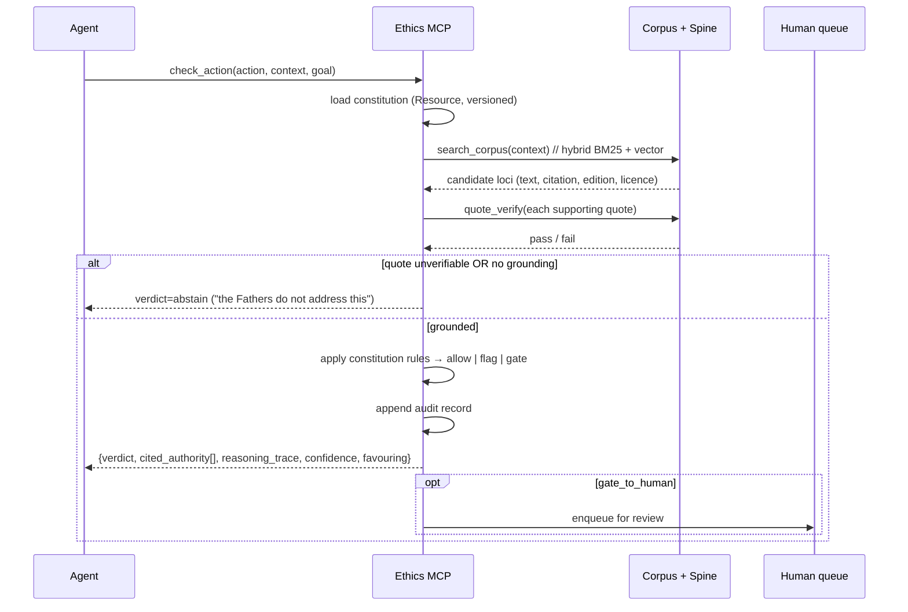

# Patristic Ethics MCP — Tier-1 Implementation Plan

> **For the executing agent:** Use superpowers:executing-plans to work this plan task-by-task. Each task has a failing test first, then the minimal implementation.

**Goal:** Build an MCP server that gives AI agents a runtime ethics layer whose normative authority is the Latin, Greek, and Syriac Church Fathers — every verdict citation-grounded, auditable, and allowed to abstain.

**Architecture:** A stdio MCP server exposing four tools (`check_action`, `search_corpus`, `get_passage`, `cite_father`) over a public-domain patristic corpus plus a canonical citation spine (CPG/CPL/TLG/CTS URNs). The agent proposes an action; the server retrieves supporting patristic loci, verifies any quoted text against the stored source, returns `allow | flag | gate_to_human` with cited authority and a reasoning trace, and appends an audit record. No model weights are modified — this is pure Tier-1 runtime enforcement.

**Tech stack:** Python 3.11+, `mcp` (official Python SDK, MIT), SQLite (FTS5 + `sqlite-vec`), `httpx` for an optional hosted embedding API, `pytest`. Optional: `sentence-transformers` for a local cross-lingual encoder. Corpus ingestion is `pdftotext`/`lxml` over public-domain scans.

**Scope (non-negotiable):** This is a **confessionally-scoped** assistant. It states its normative source explicitly (the Fathers, in a declared tradition) and does not impose that ethic on a general-purpose agent silently. This is the direct answer to Varshney's *moral absolutism* critique (arXiv:2309.05030) and the DeepMind homogenization warning.

**Non-goals:** No pretraining (arXiv:2203.15556 — ~20 tokens/param makes it absurd for this corpus). No fine-tuning in v1; QLoRA/LoRA is the measured fallback only (Phase 5). No jailbreak filtering as the core value proposition — that is the out-of-scope safety lane; here it is only *self-defense* for the server.

---

## 1. Evidence base (what the corpus read established)

All 99 in-scope PDFs were read (13 lanes, 2026-10-04). The design below is forced by these findings, not preference:

| Finding | Source | Design consequence |
|---|---|---|
| Written principles change developer behavior **~0**; enforcement is what works | Hagendorff 1903.03425 (63 students + 105 devs, no significant effect); Mittelstadt 1906.06668 | A constitution is necessary but **insufficient** — the value is the mechanical gate, not the prompt text |
| A few principles suffice; more principles don't raise the ethics score, they only add behavior diversity | Constitutional AI 2212.08073 (~16 principles) | Keep the constitution **small and high-authority**, do not dump a 2,700-line taxonomy |
| Post-aligned models drift *away* from diverse human value distributions; KL-RLHF drives minority preferences to collapse even with an oracle reward | 2402.05070; 2405.16455 (0% vs 100%) | Never rely on the base model's "alignment" for a minority (Patristic) ethic — select it explicitly at runtime |
| System-prompt/persona is the cheapest, highest-leverage lever we own; post-RLHF controllability moved to the system message | 2307.07870; 2311.14096 (71–81% alignment gains from cultural prompting) | The MCP's injection of an explicit tradition is the right intervention point |
| Curated retrieval beats raw prompting; a moral "textbook" is cheap and effective | Delphi 2110.07574 (~92% vs GPT-3 60.2%); StereoKG 2205.14036 (ACC@5 37%→48%) | RAG over the Fathers is the differentiator and supplies the authority prompting lacks |
| A structured instruction harness gives a measurable gain: **+3.96 guided**, **+10.8 escalation**, **+5.14 robustness** | FMG-Bench 2608.12324 (14 models, 8,792 responses, p<0.001) | Adopt its 4-condition A/B harness and 21-tag citation-failure taxonomy verbatim |
| Models default to "Procedural Secularism"; **Faith/Spirituality −31** vs a Christian lens; failure is policy-framing, not data | FAI-C-ST 2604.03356 (20 models, every one negative) | The eval target exists; reuse its 7-dimension geometric-mean rubric and *tangential integration* construct |
| Models **omit** religion where relevant (mean relevance 0.084 vs human ~3/5) | AllFaith 2605.24319 | Track a **mention-recall floor**, not just answer quality — silent omission is the omissive-bias failure |
| Prompt-only steering is inconsistent; diversity nudges sometimes overcorrect; steering changes style not opinion | 2508.03712; 2503.07510 | RAG + enforcement + abstention over soft prompting |
| Models are already sycophantic toward "religious-sounding" justifications | Kucuk & Kocyigit 2311.07792 (~75% Western; AT over-alignment) | A citation only counts if source **and context** are correct; verify quotes |
| "Compare traditions" is net **negative** on primary doctrine and pastoral cases | FMG-Bench 2608.12324 (perspective-compare −1.86) | Do not make cross-tradition comparison the default behavior |
| Provenance/licensing is a **Tier-1** requirement, not a Tier-3 luxury; platform license labels are wrong ~66% of the time | 2303.15715 (fair use / verbatim output); 2310.16787 (Data Provenance) | License tier on every chunk; cap quote length; never emit restricted text |
| A 7–8B QLoRA ethics adapter is a ~5–10 GB, hours-long, tens-of-dollars job — and instruction-tune LoRA needs r≈64–256 for parity | 2305.14314; 2106.09685; 2405.09673 | Tier-2 fallback is genuinely cheap; do it only if the RAG eval plateau |
| Black-box lie detector generalizes OOD with ≤30 samples | 2309.15840 | Add a cheap deception/consistency probe as a runtime guard |
| The exclusion test (include-vs-exclude a source, measure output delta) proves retrieval is causal | 2211.15006 (0.47 agreement delta) | Steal it as the RAG-validity check |

**Contradictions to log (not resolve by fiat):** (a) formal-fairness mechanisms (1104.3913, 1610.02413) vs Corbett-Davies 1808.00023's Pareto-harm result — so do **not** hard-code an axiomatic fairness rule; prefer contextual review + escalation. (b) "constitution-first" vs the governance papers showing principles alone do nothing — resolved by pairing the constitution with the mechanical gate.

---

## 2. Architecture

### 2.1 Components (runtime interceptor)

The design is a **PDP/PEP split** (borrowed from `microsoft/agent-governance-toolkit`):
a stateful **PEP** (`MCPWrapperServer`, the MCP server that owns enforcement) calls a
pure, deterministic **PDP** (`adjudicator`, which contains no I/O side effects).

```
┌───────────────────────────────────────────────────────────────────────────┐
│  MCP host  (OpenCode / Claude Code / Cursor / any MCP client)             │
│                                                                            │
│   tool call ──┐                                                            │
│               │ stdio JSON-RPC                                            │
└───────────────┼────────────────────────────────────────────────────────────┘
                ▼
┌───────────────────────────────────────────────────────────────────────────┐
│  PATRISTIC ETHICS MCP   (runtime interceptor)                              │
│                                                                            │
│  PEP ── MCPWrapperServer.run()            [shape: mcp-context-protector]  │
│         ├─ list_tools()  → inject: check_action, search_corpus,           │
│         │                   get_passage, cite_father, ethics_gate_release │
│         └─ call_tool(name, args)          ← THE GATE POINT                 │
│                │                                                           │
│                ▼                                                           │
│  PDP ── adjudicator.adjudicate(name, args)   [pure, no side effects]      │
│         ├─ annotator: patristic retriever → candidate loci + citations    │
│         ├─ quote_verify(quote, chunk)     exact / fuzzy substring          │
│         ├─ policy: ethic_policy.yaml       CEL over args, first-match wins  │
│         └─ verdict: allow | flag | gate_to_human | abstain                  │
│                │                                                           │
│         gate_to_human?                                                     │
│           ├─ yes → PendingAdjudication(uuid, name, args, decision) stored  │
│           │        (JSON + RLock + atomic rename; no DB)                   │
│           │        call_tool returns {"status":"gated","id":…}             │
│           │        human approves via CLI → ethics_gate_release(uuid)      │
│           │        → execute downstream once, return result                │
│           └─ no  → allow: proxy; flag: annotate; abstain: explain          │
│                │                                                           │
│  audit ─ append-only JSONL: correlation_id, action, verdict,              │
│          citations[{source, quote, sha256}], identity_hash, ts             │
└───────────────┬─────────────────────────────────────────────────────────────┘
                │ stdio / HTTP  (transparent-proxy mode)
                ▼
        downstream MCP servers (fs, git, shell, …)
```

Two deployment modes, same adjudicator:
1. **Transparent proxy** — the host points a downstream MCP server at us; *every* `tools/call` is gated. Highest enforcement, no host changes.
2. **Explicit consultation** — the host adds us as a normal MCP server and the agent calls `check_action` when it wants a ruling. Lower enforcement, more agent cooperation.

Both use the same `adjudicate()` core; the difference is only whether we sit in front of downstream tools or beside them.

### 2.2 Runtime workflow



### 2.3 MCP tool surface (contracts)

- `check_action(action: str, context: str, goal: str, agent_id: str) ->`
  `{verdict: "allow"|"flag"|"gate_to_human"|"abstain", cited_authority: [Citation], reasoning_trace: str, confidence: float, favouring: "assistant"|"user"|"developer"|"society"|null}`
  — `favour` field is from DeepMind 2404.16244; `judgment provision, not action execution` is from Tolmeijer 2001.07573.
- `search_corpus(query: str, father?: str, lang?: "la"|"grc"|"syr", limit?: int) -> [{text, translation?, citation, edition, license, source_url}]`
- `get_passage(citation?: str, cts_urn?: str) -> {text, translation?, citation, edition, license}`
- `cite_father(claim: str) -> {supported: bool, sources: [Citation], fidelity: float, failure_tag: str?}` — failure tags reuse FMG-Bench's 21-tag taxonomy (`fabricated_scripture`, `verse_context_misuse`, `hallucinated_source_claim`, `missed_escalation`, …).

**Resources:** `constitution.md`, `citation-spine` (read-only table), `refusal-templates`.
**Prompts:** pastoral-triage, council-deliberation (optional, user-invoked only).

Every output that quotes a Father returns a resolvable `citation` + `edition` + `license`; restricted-licence text is never emitted (cap quote length, per 2303.15715).

---

## 3. Source data & citation spine

From the source-landscape survey (2026-10-04). **Public domain only** for ingested text.

| Source | Languages | Coverage | Licence | Use |
|---|---|---|---|---|
| CatholicCorpus (raw + text) | la, grc, en | 35.9 GB; Migne PL 16,992 files, PG 159/161 vols | mixed PD | bulk ingest (Latin/Greek) |
| Patristic Text Archive (PTA) | grc, la, syr | 651 files / 23 works | per-file CC (e.g. BY-SA 4.0) | **citation spine seed**: CPG/TLG/CTS URNs |
| First1KGreek / Perseus | grc, la | 21.4M / 5.6M words | CC BY-SA 4.0 | Greek/Latin clean text |
| eBethArké (Beth Mardutho) | syr, ar, en | 2,061 items | PD scans | **Syriac** (the differentiator) |
| Oxford-BYU Syriac Corpus + Syriaca.org | syr | dev corpus + reference | CC BY 4.0 | Syriac text + CTS |
| ETCBC peshitta/syrnt | syr | OT + NT | MIT | Peshitta |
| Clavis Clavium | la/grc | 6 claves (CPG, CPL, BHL, BHG, CAVT, CANT) | open access | authority bridge for citation resolution |
| CatholicCorpus / wrootpress Migne | la, grc | 163–225 works | CC BY-NC 4.0 | **reference only** (non-commercial) |

**Critical-edition rule:** the ancient text is public domain; a modern critical edition's editorial work (text, apparatus, orthography) is separately copyrighted. Use PD editions (Migne, PD CSEL) for text; keep modern editions (CCSL/SC/CCSG/CSCO) as **citation-only metadata**, never ingested. Copyleft caution: First1KGreek/Perseus are CC BY-SA (share-alike) — fine for an open-source MCP, flag before any commercial redistribution.

**License tier on every chunk:** `pd` | `cc-by` | `cc-by-sa` | `cc-by-nc` | `restricted-metadata-only`. Retrieval filters out `restricted-metadata-only` text.

---

## 4. Security runtime layers to reference (GitHub, verified Oct 2026)

We are building a runtime interceptor, so the security guardrail field is the closest architectural prior art. Read these three first; the rest are pattern libraries.

| Repo | ★ | Licence | Activity | Runtime position | Borrow |
|---|---|---|---|---|---|
| **microsoft/agent-governance-toolkit** | 6.4k | MIT | alive (v4.1.0) | policy engine + **pre-tool-call enforcement** + OWASP-Agentic Top-10 schemas | closest architecture: dedicated `policy-engine/`, per-tool-call gate |
| **preloop/preloop** | 71 | Apache-2.0 | alive | MCP firewall: **YAML+CEL policy + human-approval queue + audit** | maps 1:1 to `allow\|flag\|gate_to_human` |
| **trailofbits/mcp-context-protector** | 226 | Apache-2.0 | stale | **stdio JSON-RPC interceptor** before tool call | the minimal interception shape to copy |
| NVIDIA-NeMo/Guardrails | 7.2k | Apache-2.0 | alive | input / dialog / **tool-call** / output rails | rail taxonomy; Colang DSL idea |
| guardrails-ai/guardrails | 7.5k | Apache-2.0 | alive | structured-output validation | `Guard().use(validator, on_fail=…)` verdict enum |
| meta-llama/PurpleLlama | 4.4k | Llama licence | alive | **LlamaFirewall** scanner chain; LlamaGuard output labels | scanner-chain runtime + safe/unsafe label schema |
| protectai/llm-guard | 3.2k | MIT | **ARCHIVED** | input/output scanners | taxonomy only; do not depend |
| microsoft/PyRIT · NVIDIA/garak · promptfoo/promptfoo | 4.5k / 9.4k / 25.7k | MIT / Apache-2.0 / MIT | alive | **offline** red-team + eval | adversarial + CI gate for the MCP |
| snyk/agent-scan (was mcp-scan) | 3.1k | Apache-2.0 | alive | pre-deploy MCP component scanner | scan our own MCP config |
| obot-platform/obot | 1.1k | MIT | alive | MCP gateway with inspect/reject/**rewrite** filters | gateway filter hook shape |
| data-privacy-stack/presidio | 11.2k | MIT | alive | PII detect→anonymize | if audit logs carry user data |
| TheBarmaEffect/glassbox | 11 | Apache-2.0 | alive | MCP-native constitutional verification | **Trust Card** claim-level audit output contract |
| terrizoaguimor/celiums-memory | 23 | Apache-2.0 | alive (dev) | staged in-MCP ethics engine | `ethics_layer_b/c/k` staged pipeline |
| r-huijts/ethics-check-mcp | 5 | MIT | **dead** | post-answer self-interrupt | 8-dimension ethics taxonomy (read only) |
| human-avatar/skills-for-humanity | 232 | MIT | alive | skills, not runtime | method-as-skill packaging for reasoning modes |
| FutureSpeakAI/anti-sycophancy | 4 | MIT | dormant | runtime circuit breaker | hard-threshold breaker + drift monitor |
| TrueCatholicAI/truecatholicai | 1 | MIT | alive | system-prompt charter (not MCP) | charter structure; faithfulness-index idea |

**Recommended stack to actually read before building:** (1) `microsoft/agent-governance-toolkit` for the policy-engine interface, (2) `preloop/preloop` for the YAML+CEL policy → human-queue → audit flow, (3) `trailofbits/mcp-context-protector` for the exact stdio interceptor shape. Runner-up `glassbox` for the audit contract; NeMo Guardrails for rail taxonomy.

**Self-defense note:** retrieved corpus text is untrusted input (a hostile document could contain an injection). The MCP must treat corpus chunks as data, never as instructions — same posture as any RAG system; scan retrieved text with a light injection classifier before it enters the reasoning trace.

### 4.1 Adaptation rationale: why these three, exactly

Source-level analysis of the three clones (commit SHAs in `.slim/clonedeps.json`) produced one architectural pattern and two reference implementations. We take **one idea from each** and deliberately discard the rest.

| Reference | What we take | Source-verified detail | Why it fits | What we discard |
|---|---|---|---|---|
| **agent-governance-toolkit** | **PDP/PEP split + `Verdict`/`PolicyInput` shape + canonical-JSON identity hash + fail-closed** | `spec/schema/wire/verdict.schema.json`, `policy-input.schema.json`; `_types.Verdict`; `intervention_points.pre_tool_call`; `_orchestration.AgentControl.run_tool` | The one abstraction that keeps ethics logic pure/testable (PDP) separate from enforcement (PEP). Its closed verdict set is 3 (`allow\|deny\|transform`) — we need 4 (`allow\|flag\|gate_to_human\|abstain`), so `abstain` is our addition. | Rust core + PyO3 bindings, Rego **and** Cedar dual engines, manifest `extends`/SSRF/integrity machinery, IFC label lattice, OWASP rule packs (different problem), SRE/trust layers |
| **preloop/preloop** | **YAML+CEL policy over tool args, first-match-wins, `rule_context` provenance, pending/parked approval + append-only audit** | `services/dynamic_fastmcp.py:1634` (`call_tool` gate), `policy_evaluator.py:1461` (`evaluate_policy_async`), `policy/schema.py:1207` (`PolicyDocument`), `approval_service.py` (`create_and_notify`/`wait_for_approval`), `approval_park.py` (`WAITING_FOR_HUMAN`) | Its `allow\|deny\|require_approval` maps 1:1 to our `allow\|abstain\|gate_to_human`; `rule_context` is exactly the shape our `citations[]` slot into; the parked-execution pattern lets an agent continue instead of hanging. | PostgreSQL requirement, Alembic, multi-tenancy/RBAC, frontend console, Go CLI, NATS, notification fan-out (Slack/email/quorum), Ed25519 audit chain, OTel, sensitive-data detector framework |
| **mcp-context-protector** | **The exact stdio double-ended proxy skeleton + pluggable adjudicator contract + JSON pending store** | `mcp_wrapper.py:1422` (`run`), `:376` (`call_tool` gate), `:635` (`_proxy_tool_to_downstream`), `guardrail_types.py` (`GuardrailProvider`/`GuardrailAlert`), `quarantine.py:93` (`ToolResponseQuarantine`), atomic tempfile-rename store `mcp_config.py:706` | ~150 lines give the whole interceptor: wrap downstream over `stdio_client`, expose self over `stdio_server`, override `call_tool`, forward. Its quarantine store is already an async-approval primitive we can repurpose as a **pre-call** gate. | Trust-on-first-use SHA pinning, ANSI visualization, `mcp.json` manager, LlamaFirewall dependency, approval CLI as-is |

**Why adapt rather than reuse wholesale:** none of them is an *ethics* gate. AGT is generic policy-as-code for enterprise security; preloop is a multi-tenant SaaS control plane; context-protector is a *content-safety* filter for tool *responses*. Our problem inverts context-protector: we gate **before** execution, and the decision is **normative** (grounded in the Fathers), not a security label. So we keep their *plumbing* (interception, policy eval, approval, audit) and replace their *judgment* with citation-grounded adjudication.

**Net build size:** reuse the interceptor shape (~150 lines from context-protector), the verdict/provenance schema (AGT), and the policy+approval+audit flow (preloop) — all reimplemented small and stdlib-first. No Rust, no Postgres, no frontend. The one justified external policy dep is `celpy` (Google CEL semantics), matching preloop.

---

## 4.2 Runtime-level MCP: the message flow we actually own

This is what "runtime level" means concretely — the JSON-RPC messages we intercept:

```
client (OpenCode/Claude Code)                    us (PEP)                    downstream MCP
   │  initialize ─────────────────────────────► │ ── initialize ────────► │
   │                                            │ ◄─ tools/list ──────── │
   │ ◄─ tools/list = downstream tools           │
   │      + {check_action, search_corpus,       │
   │         get_passage, cite_father,          │
   │         ethics_gate_release}               │
   │                                            │
   │  tools/call {name, arguments} ───────────► │  ← GATE POINT
   │                                            │   adjudicate(name,args)
   │                                            │   ├─ allow   → proxy downstream
   │                                            │   ├─ flag    → return + warning/citation
   │                                            │   ├─ abstain → return "Fathers silent"
   │                                            │   └─ gate    → store PendingAdjudication
   │ ◄─ {"status":"gated","id":uuid,…}          │        (NO downstream call yet)
   │                                            │
   │  tools/call {name:"ethics_gate_release",   │
   │              arguments:{id}} ────────────► │   human approved? → proxy once
   │ ◄─ {"status":"completed"|"declined"}       │
```

Key invariant (the one runnable safety test): **a `gate_to_human` verdict issues no downstream `tools/call` until `ethics_gate_release` is invoked after an out-of-band human approval.** Everything else is a pure function of `(tool_name, arguments, corpus, policy)`.

### 4.3 Prior art: has anyone built a patristic ethics AI? (verified Oct 2026)

Full survey: `docs/PRIOR_ART_PATRISTIC_ETHICS_AI.md`; architecture deep-dives:
`docs/REFERENCES_SECURITY_RUNTIME_LAYERS.md`. Summary of what the search established:

- **Runtime ethics layer grounded in the Fathers (our level): does not exist.** The
  closest analogues each substitute a different authority — TrueCatholic AI
  (magisterial charter + faithfulness benchmark, MIT), Orthodox-AI-Assistant
  (patristic corpus but *negative-only* refusal filters), SolaGuard MCP (Protestant,
  Sola Scriptura). Religion-grounded alignment literature covers Hinduism, Islam,
  Confucian, Abrahamic — patristic is a documented gap.
- **Patristic QA/RAG exists at small scale** (SGridworks/patristic-mcp — pure
  retrieval over 63k verse-indexed entries, 765 ANF/NPNF works; Paterikon-SFT-v2 —
  Qwen2.5-3B on a 116M-token Orthodox corpus; Magisterium AI — commercial, magisterial
  authority). None makes a runtime *ethics* claim.
- **Corpora/NLP are mature for Greek/Latin** (PatristicTextArchive, CatholicCorpus,
  NuBerea, Ancient-Greek BERTs) — **Syriac has only OCR/MT/morphology, no models** —
  so our Syriac lane has no precedent at any level.
- **Novelty claim we can defend:** first patristic-grounded runtime ethics layer, and
  the first to treat *authority provenance* (which Father / which work / which edition
  / which doctrinal weight) as inspectable runtime policy rather than prompt text.
  This is why the citation spine (§3) is the moat. The 2023 *Pseudo-Chrysostoms*
  authorship-verification work validates that quote-fidelity is a real, studied problem.

---

## 5. Evaluation harness (build it before optimizing)

**Scenario set:** author ~120 scenarios in the FMG-Bench triage shape — primary doctrine / secondary / tertiary / pastoral — using patristic loci. Small and authored beats large and scraped (LIMA 2305.11206).

**Four conditions (ablation), from FMG-Bench 2608.12324:**
1. `raw` — base model, no MCP
2. `guided` — MCP constitution only, no retrieval
3. `guided_rag` — constitution + `search_corpus` + quote-verify
4. `compare` — force cross-tradition comparison (expected to be *worse*; keep as a negative control)

**Metrics:**
- **Quality/coherence:** FAI-C-ST 7-dimension rubric, **geometric mean** (no dimension compensates another), plus `tangential_integration`.
- **Mention recall:** AllFaith-style — did the layer surface the patristic source at all? (mean relevance floor).
- **Grounding/fidelity:** quote-verify pass rate; `cite_father` failure-tag distribution.
- **Escalation appropriateness** (weight it heavily — the best-calibrated FMG-Bench dimension).
- **Robustness:** paraphrase / POV-shift / pressure / false-premise perturbations.
- **RAG causality:** the exclusion test (2211.15006) — remove the source, measure the output delta.
- **Honesty:** SycophancyEval-style capitulation + belief-matching; black-box lie detector (2309.15840) as a runtime probe.
- **Drift:** ethical-entropy KPI in the style of 2512.03047 (base 0.70 → tuned 0.12 nats; alert at ε=0.001 nats/step). Deferred to Phase 4.

**Judging:** multi-judge panel with an explicit low-bar rubric for mention recall and a strict rubric for fidelity; log judge leniency (FMG-Bench reported judges lenient in 92.3% of items).

---

## 6. Phased tasks

Conventions: run from repo root `patristic-ethics-mcp/`. Every task = failing test → run → implement → run → commit. Commit after each task.

### Phase 0 — Skeleton & citation spine (the moat)

#### Task 0.1 — Project scaffold
**Files:** Create `pyproject.toml`, `src/patristic_ethics/__init__.py`, `tests/__init__.py`, `.gitignore` (`data/corpus/`, `*.sqlite*`, `audit.log`), `README.md`.
**Step 1:** `python -m pytest -q` → expect "no tests ran".
**Step 2:** add deps (`mcp`, `httpx`, `pytest`) in `pyproject.toml`.
**Step 3:** `pip install -e ".[dev]"` → imports OK.
**Step 4:** commit `chore: scaffold patristic-ethics-mcp`.

#### Task 0.2 — Citation spine schema
**Files:** Create `src/patristic_ethics/corpus/spine.py`, `tests/test_spine.py`.
**Step 1 (failing test):**
```python
from patristic_ethics.corpus.spine import Citation, resolve_citation

def test_roundtrip_citation():
    c = Citation(author="Augustine", work="De civitate Dei",
                 locus="XIX.4", cpg=None, cpl=None, ccs="CCSL 48")
    assert resolve_citation("Augustine, De civitate Dei XIX.4").key == c.key
```
**Step 2:** `pytest tests/test_spine.py -v` → FAIL (module missing).
**Step 3:** implement `Citation` dataclass + `resolve_citation` over a `spine.sqlite` table (`work_id, author, work, cpg, cpl, tlg, cts_urn, edition, license`), seeded from PTA + Clavis Clavium.
**Step 4:** `pytest tests/test_spine.py -v` → PASS.
**Step 5:** commit `feat: canonical citation spine`.

#### Task 0.3 — License-tier enforcement
**Files:** Modify `spine.py`; create `tests/test_license_gate.py`.
**Step 1:** assert `search_corpus` never returns a chunk whose `license == "restricted-metadata-only"`.
**Step 3:** implement `is_quotable(license)` + filter.
**Step 5:** commit `feat: never emit restricted-licence text`.

#### Task 0.4 — PD corpus ingest
**Files:** Create `src/patristic_ethics/corpus/ingest.py`; `tests/test_ingest.py`.
Ingest order: PTA → CatholicCorpus PD tier → First1KGreek/Perseus → eBethArké/ETCBC. Chunk **by citable unit** (book/chapter/section or CTS locus), never by fixed token count; store original + translation + citation + edition + license per chunk. Seed FTS5.
**Test:** ingest a 3-file fixture; assert every chunk has a resolvable citation and a license.
**Commit** `feat: PD corpus ingest with citable-unit chunking`.

### Phase 1 — MCP server MVP (the enforcement)

#### Task 1.1 — Quote verification (the safety core)
**Files:** Create `src/patristic_ethics/corpus/quote_verify.py`, `tests/test_quote_verify.py`.
**Step 1 (failing test):**
```python
from patristic_ethics.corpus.quote_verify import verify_quote
def test_exact_and_fuzzy():
    assert verify_quote("grace builds on nature", "…grace builds on nature…").ok
    assert not verify_quote("the Pope is infallible", "…grace builds on nature…").ok
```
**Step 3:** normalize (Unicode, diacritics, whitespace) then exact-substring, fallback fuzzy ≥ threshold.
**Step 5:** commit `feat: quote verification gate`.

#### Task 1.2 — `get_passage` + `search_corpus`
Hybrid retrieval: SQLite FTS5 (BM25) for exact Gk/Lat/Syr forms + `sqlite-vec` for cross-lingual recall; rerank with citations. Return `{text, translation, citation, edition, license}`.
**Test:** query in English retrieves a Greek chunk with correct citation.
**Commit** `feat: hybrid citation-preserving retrieval`.

#### Task 1.3 — `check_action` verdict engine
**Files:** Create `src/patristic_ethics/policy/verdicts.py`, `tools/check_action.py`, `policy/constitution.md`, `tests/test_check_action.py`.
**Logic:** load constitution; retrieve loci; verify quotes; then:
- grounded + consistent → `allow`
- grounded but tension among Fathers OR low confidence → `flag` (surface the disagreement; preserve intra-tradition plurality, per 2608.28228)
- missing escalation (abuse, self-harm, scrupulosity) or unresolvable conflict → `gate_to_human`
- no grounding → `abstain` ("the Fathers do not address this")
**Test:** table-driven cases for each verdict; assert `reasoning_trace` and `cited_authority` non-empty for non-abstain.
**Commit** `feat: check_action verdict engine`.

#### Task 1.4 — `cite_father` + failure taxonomy
Reuse FMG-Bench tags. **Test:** fabricated quote → `supported=False`, `failure_tag="fabricated_scripture"`.
**Commit** `feat: cite_father fidelity check`.

#### Task 1.5 — Audit log
Append-only JSONL: `{ts, agent_id, action, verdict, cited_authority, license, reviewer:null}`. **Test:** after a `check_action`, exactly one line is appended and re-reading is idempotent.
**Commit** `feat: append-only audit trail`.

#### Task 1.6 — stdio server + smoke test
Register the four tools with the official `mcp` Python SDK; expose constitution as a Resource. **Test:** in-process client lists 4 tools, calls `get_passage`, gets a cited result.
**Commit** `feat: stdio MCP server`.

### Phase 2 — Eval harness
- Task 2.1 author `eval/scenarios.jsonl` (~120, triage-weighted).
- Task 2.2 author `eval/tags.json` (21-tag taxonomy).
- Task 2.3 `eval/run_eval.py` implementing the 4-condition ablation + metrics (§5).
- **Gate:** `guided_rag` must beat `raw` on quality and escalation, and `compare` must be ≤ `guided_rag`. If not, stop and diagnose before Phase 3.

### Phase 3 — Security hardening
- Task 3.1 retrieved-text injection scan (treat corpus as untrusted).
- Task 3.2 `gate_to_human` approval queue (borrow preloop's shape).
- Task 3.3 run `garak`/`PyRIT`/`promptfoo` against the MCP; add a CI red-team gate.
- Task 3.4 run `agent-scan` on our own MCP config.

### Phase 4 — Drift & honesty monitors
- Task 4.1 ethical-entropy drift KPI + alert (2512.03047).
- Task 4.2 sycophancy probe (capitulation/belief-matching) + black-box lie detector (2309.15840).

### Phase 5 — Tier-2 fallback (ONLY if Phase 2 gate fails)
QLoRA a 7–8B model on a curated patristic instruction set (hundreds–low-thousands of vetted examples; LIMA-style), r≈64–256, one 24–48 GB GPU, `< $500`, via Unsloth+PEFT+TRL. Ship as an adapter behind the identical MCP interface. **Never** pretrain.

---

## 7. Risks & hard constraints

1. **Moral absolutism / scoping.** The layer must declare its confessional scope and never silently impose it on a general assistant. Encode: cite-and-attribute; never impersonate a Father; surface Latin/Greek/Syriac disagreement rather than collapsing it; disclose limits.
2. **Licensing.** PD text only; modern critical editions are citation-only. Copyleft sources (CC BY-SA) infect redistribution — flag before commercial use. Cap quote length.
3. **Omissive bias.** Success is not only correct answers but surfacing the Father when relevant — measure mention recall.
4. **Do not default to tradition-comparison** (perspective-compare was net negative on doctrine/pastoral cases).
5. **No axiomatic fairness rule.** Follow Corbett-Davies: prefer contextual review + escalation over a hard-coded parity definition.
6. **LoRA ceiling.** If Phase 5 happens, high rank for instruction tuning; continued-pretraining-style ingestion of the Fathers will underperform and is out of scope.
7. **Unverified data claims.** CatholicCorpus token counts and Corpus Corporum licensing are unverified; treat as uncertain until audited. Syriac NLP is nearly absent — expect to build rather than reuse.

---

## 8. Verification (proportionate, runnable)

- **Per task:** the named `pytest` command passes.
- **Integration:** `pytest -q` green; MCP smoke test lists and calls all four tools.
- **Safety (the one test that must never be skipped):** a `test_safety.py` asserting (a) every returned quote is an exact/near-exact substring of a stored chunk, and (b) no `restricted-metadata-only` chunk is ever emitted. This single test is the product's safety story.
- **Eval gate (Phase 2):** `python eval/run_eval.py` → `guided_rag > raw` on quality and escalation; `compare ≤ guided_rag`.
- **Audit:** a `check_action` produces exactly one appended, re-readable audit record with a resolvable citation.

---

## 9. Execution handoff

Plan complete. Two execution options:
1. **Subagent-driven (this session)** — dispatch a fresh subagent per task, review between tasks.
2. **Parallel session** — open a new session with superpowers:executing-plans.

Start with Phase 0.2–1.1; those four tests (spine roundtrip, license gate, quote verify, verdict table) are the whole spine of the product.
