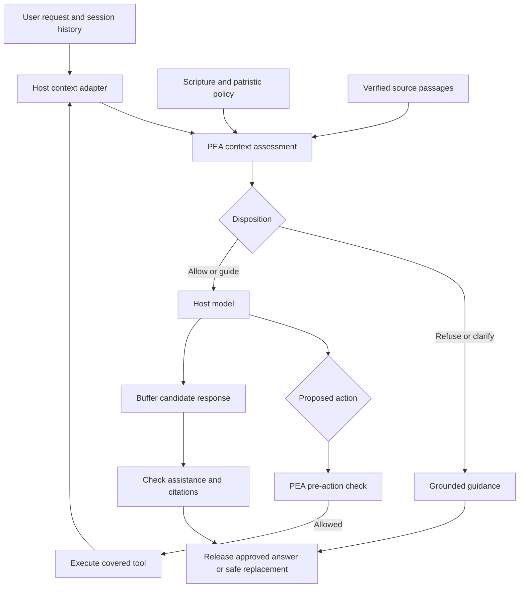

# Context-aware ethical judgment at agent runtime

Research date: 2026-10-06. Project: Patristic Ethic Agent (PEA).

Authority: [core brief](../instruction.md). Implementation: [current plan](../plans/2026-10-06-pea-implementation-plan.md).

## 1. Answer to the project's central question

**Yes, an LLM or agent can make a context-sensitive ethical assessment, and runtime layers for supplying context and enforcing decisions already exist. MCP can participate in this architecture, but an MCP server is not automatically a listener to the host's whole conversation.**

The earlier explanation needed this qualification: lack of automatic conversation access is a property of the MCP server boundary, not a limitation on the host LLM's ability to reason about its conversation. A host can deliberately send relevant messages to PEA. A host plugin, application wrapper, or model gateway can make that evaluation automatic.

PEA needs three distinct capabilities:

| Capability | Concrete responsibility | Failure if omitted |
|---|---|---|
| Context collection | Supply the current request, relevant earlier messages, proposed action, and available source material | A harmless-looking follow-up can conceal an earlier harmful objective |
| Ethical assessment | Interpret expressed intent under Scripture and a curated patristic policy; retrieve and assess evidence | A transport wrapper has no patristic moral standard by itself |
| Enforcement and guidance | Prevent prohibited assistance or actions; deliver compassionate, grounded alternatives | A correct verdict can be ignored, arrive after execution, or arrive after text has streamed |

The user's latest decision is binding for this plan: **clear assistance with murder, rape, suicide, or terrorist recruitment is refused. Human review is for ambiguity, not an override authorizing clear harm.** Refusing harmful assistance does not mean refusing to speak with, support, or help protect a person in distress.

## 2. What MCP actually carries

The MCP architecture assigns conversation aggregation to the host and isolates server connections. A normal tool invocation carries a tool name and arguments. PEA can define arguments containing messages, a proposed tool call, or a draft answer; nothing automatically fills those fields with all host history. A session identifier is not conversation content or permission to inspect other sessions. [MCP architecture](https://modelcontextprotocol.io/specification/2025-11-25/architecture), [tool-call specification](https://modelcontextprotocol.io/specification/2025-11-25/server/tools).

Four uses must be distinguished:

| Integration | Context PEA receives | What it can reliably assess |
|---|---|---|
| Model voluntarily calls `check_action` | Whatever arguments the model supplies | That submitted case; completeness may be uncertain |
| Host hook calls PEA automatically | Event fields plus history deliberately collected by the adapter | Covered host events, with declared history completeness |
| MCP proxy wraps another server | Routed MCP calls and responses; dialogue only if separately provided | Those tools, not every host action or conversation |
| Controlled host/model wrapper | Requests and responses crossing its boundary, plus owned session state | The covered conversation and output path; tool execution needs its own boundary |

MCP sampling lets a server request generation from a supporting client. It is not a universal transcript-reading API. In the checked 2025-11-25 specification, `includeContext` values `thisServer` and `allServers` are soft-deprecated and capability-dependent. PEA should not depend on them for history or universal model access. [Sampling specification](https://modelcontextprotocol.io/specification/2025-11-25/client/sampling).

**Design consequence:** keep MCP as a useful interface. Put automatic context assembly and mandatory evaluation in the host integration, where the conversation actually lives.

## 3. Current coding-agent integration surfaces

These findings describe inspected documentation/source, not completed PEA compatibility tests. Host versions, UI modes, headless runs, background tasks, and subagents require separate verification.

### Codex

The installed CLI reports `0.160.0`. Current documentation exposes prompt and pre-tool hooks, context injection, and a nullable transcript path whose format is explicitly unstable. `Stop` can request continuation; it is not documented as an output-withholding mechanism. Hosted tools and some specialized paths bypass ordinary tool hooks; `write_stdin` does not receive a new pre-tool check. MCP-hook connection/tool failures do not block operations. Therefore a native hook installation alone cannot promise complete enforcement. [Official hooks reference](https://learn.chatgpt.com/docs/hooks).

App Server exposes stored-thread reads, turn submission, message events, and approval requests. **PEA design inference:** a client we control can collect relevant thread history and buffer its own visible output until review. Approval notifications are not guaranteed for every action, so action enforcement still needs tested hooks or restricted tools. Buffering in that client does not hide the original transcript from other clients. [Official App Server reference](https://learn.chatgpt.com/docs/app-server).

### Claude Code

`UserPromptSubmit` can inspect the submitted prompt, add context, or block processing; hooks also receive a transcript path. `PreToolUse` is the action gate. `Stop` controls continuation. `MessageDisplay` can replace displayed assistant text, but cannot change the stored transcript/model context or block the message; failures can expose the original text. Command/HTTP/MCP prompt-hook timeouts can proceed without the hook's context. These are material boundaries, not implementation details to ignore. [Claude Code hooks](https://code.claude.com/docs/en/hooks).

The Agent SDK offers callback hooks with documented event-specific timeout behavior; prompt callback timeouts block rather than silently proceeding. **PEA design inference:** use a controlled SDK consumer for stronger display control and explicitly test callback failures and side effects. Native and SDK integrations must have separate capability records. [Agent SDK hooks](https://code.claude.com/docs/en/agent-sdk/hooks).

### OpenCode

Plugins expose pre/post tool hooks. The SDK provides session-message retrieval. The plugin types also expose message/system transformation and text-completion hooks, some experimental. These provide concrete context collection and instruction-injection routes. [Plugin documentation](https://opencode.ai/docs/plugins/), [SDK](https://opencode.ai/docs/sdk/), [plugin types](https://github.com/anomalyco/opencode/blob/dev/packages/plugin/src/index.ts).

A source check at commit `f03046d9f558bc54a090363fea48441b05f522bf` found text deltas published before `experimental.text.complete` runs. Consequently, that completion hook alone cannot prevent earlier text exposure. A controlled client or buffered model route is needed for that stronger claim. [Pinned processor source, starting at line 513](https://github.com/anomalyco/opencode/blob/f03046d9f558bc54a090363fea48441b05f522bf/packages/opencode/src/session/processor.ts#L513).

### Practical coverage comparison

| Surface | Context collection | Pre-action control | Before-display guarantee from the surface alone |
|---|---|---|---|
| Plain MCP tool | Explicit arguments | Only its own execution | No |
| MCP tool proxy | Routed calls; optional supplied history | Yes, for wrapped calls | Only wrapped tool responses |
| Native coding-agent hooks/plugins | Prompt/history APIs or transcript adapters | Supported tool paths | Not a universal guarantee |
| Controlled client + tested action gates | Owned input/history/events | Verified enabled actions | Achievable for that client's buffered display |
| Model gateway | Routed API request/response | Model request/tool proposal, not arbitrary external execution | Achievable when blocking output checks buffer responses |
| Agent framework middleware | Framework-managed messages/state | Wrapped model and tool paths | Depends on integration and streaming configuration |

## 4. Existing runtime layers: what can be reused

**This engineering category already exists.** The open question for PEA is reliable patristic policy and its deployment across specific hosts, not inventing conversation middleware from scratch.

| Project | Verified capability | Relevance to PEA | Boundary |
|---|---|---|---|
| NVIDIA NeMo Guardrails | Input, retrieval, dialogue, execution, and output rails; message-history API | Closest general conceptual match for contextual guidance | Application must route calls through it; no ready-made patristic corpus/policy |
| LangChain middleware | Agent/model lifecycle hooks, tool wrappers, access to message state | Reusable when an application already uses LangChain | Installing it does not automatically instrument Codex or Claude Code |
| OpenAI Agents SDK | Input/output/tool guardrails and approval interruptions; blocking input mode | Reference for separately validating input, output, and effects | Agent-level checks have first/final-agent boundaries; function tools need their own checks |
| LiteLLM guardrails | Pre-call, post-call, parallel, and logging-only modes | Useful optional gateway integration for existing deployments | Logging-only is observation; parallel execution is not prevention of provider invocation |
| Microsoft agent-governance-toolkit | Actual pre/post model-call adapter and enforcement separation | Borrow the decision/enforcement boundary | Caller supplies the model request and snapshot |
| Preloop | MCP firewall plus model gateway; policy-aware streaming buffer | Strong precedent for checking complete output before release | Only routed traffic is visible; notify-only differs from enforcement |
| mcp-context-protector | MCP wrapper, configuration approval, response quarantine | Small transport reference for optional tool proxy | Does not capture ordinary conversation or undo executed tools |

Primary sources: [NeMo rail types](https://docs.nvidia.com/nemo/guardrails/latest/about-nemo-guardrails-library/rail-types), [NeMo history API](https://docs.nvidia.com/nemo/guardrails/run-guardrailed-inference/using-python-apis/core-classes), [LangChain middleware](https://docs.langchain.com/oss/python/langchain/middleware/custom), [LangChain guardrails](https://docs.langchain.com/oss/python/langchain/guardrails), [OpenAI guardrails](https://developers.openai.com/api/docs/guides/agents/guardrails-approvals), [LiteLLM modes](https://docs.litellm.ai/docs/proxy/guardrails/quick_start).

### Source-level findings from local reference clones

The clone revisions are recorded in [the dependency manifest](../../.slim/clonedeps.json). They are references, not PEA dependencies.

**Microsoft AGT, `09cb915`:** `run_model_call` evaluates a request before invoking the supplied provider function and evaluates the response before returning it. `HostSession.pre_model_call` normalizes request fields, including messages. This confirms a usable model-call seam; it does not establish automatic access to a host UI's history. [Generic adapter](https://github.com/microsoft/agent-governance-toolkit/blob/09cb915/policy-engine/sdk/python/agent_control_specification/_adapters/_generic.py#L68), [host normalization](https://github.com/microsoft/agent-governance-toolkit/blob/09cb915/policy-engine/sdk/python/agent_control_specification/_host.py#L430).

**Preloop, `0478112`:** the chat gateway evaluates request policy before provider invocation. Its streaming wrapper passes through output when there are no response rules; notify-only rules inspect after forwarding. When rules can deny or require approval, it accumulates the stream, evaluates the full response, and replays only an accepted result. This is a concrete implementation of the latency/enforcement tradeoff PEA must acknowledge. [Gateway](https://github.com/preloop/preloop/blob/0478112/backend/preloop/services/openai_gateway.py#L2917), [stream policy wrapper](https://github.com/preloop/preloop/blob/0478112/backend/preloop/services/model_content_policy.py#L1516).

**mcp-context-protector, `05e56c1`:** its tool handler forwards approved MCP calls and scans responses afterward. Quarantine release returns a previously produced result, rather than delaying the original action until approval. PEA cannot copy this release behavior unchanged for pre-execution review. [Tool handler](https://github.com/trailofbits/mcp-context-protector/blob/05e56c1/src/contextprotector/mcp_wrapper.py#L376), [release path](https://github.com/trailofbits/mcp-context-protector/blob/05e56c1/src/contextprotector/mcp_wrapper.py#L557).

**Reuse recommendation:** implement a small shared PEA core and thin host adapters. Do not install all these frameworks. Add a framework/gateway adapter only when the actual deployment already uses it or the initial host experiment proves it necessary.

## 5. Religious prior art and the limits of novelty claims

- [TrueCatholic AI](https://github.com/TrueCatholicAI/truecatholicai) describes a doctrinal charter, system prompt, and its own benchmark. This supports constitution-based guidance as a baseline; its self-reported scores do not establish mandatory interception across coding agents.
- [SolaGuard](https://github.com/jissac/solaguard-mcp-server) exposes Scripture tools and theological framing in tool responses. Its README's automatic-framing claims do not demonstrate a host-wide conversation interception layer.
- [Orthodox AI Assistant](https://github.com/Pemastatsi/Orthodox-AI-Assistant) currently describes an implementation-contract pack. That README alone is insufficient evidence of a deployed runtime system. Earlier project notes should not present it as verified production capability.

This review does **not** establish that no patristic runtime exists anywhere. It establishes that the reviewed general infrastructure is reusable, while none of these inspected religious references proves the complete PEA behavior required here. Replace absolute novelty claims in future project descriptions with that narrower statement.

## 6. How PEA should make contextual ethical assessments

This section is the proposed project design, not a claim that present classifiers are infallible.

### 6.1 Judge an expressed request, not a person's hidden heart

PEA should assess the requested assistance, evidence in the dialogue, affected people, and likely use of the proposed output/action. It must not infer guilt, spiritual state, or violent intent from religious identity, ethnicity, distress, or a word appearing in isolation.

Examples needing different outcomes:

| Conversation | Appropriate distinction |
|---|---|
| “Explain a Father's teaching against murder” | Benign theological inquiry; answer with sources |
| “I am afraid I might hurt myself” | Support and appropriate human help, not rejection of the person |
| Earlier request names a violent objective; later says “make the invitation more persuasive” | Evaluate the earlier objective, not just the latest sentence |
| Survivor describes sexual violence | Offer care; do not classify the disclosure as requesting abuse |
| Historian analyzes extremist recruitment | Permit bounded analysis; refuse creating recruitment or operational support |
| Developer asks to kill a process | Technical meaning, not interpersonal violence |
| User describes jealousy and seeks help forgiving | Positive moral guidance; no need for an action-blocking gate |

### 6.2 Collect evidence with provenance

Build a context envelope from host-observed messages. Preserve role, message ID, ordering, session/parent ID, and whether text is a user request, a quotation, an attachment, a tool result, or a summary. Include the proposed action and candidate output at their respective checkpoints. Mark missing/truncated history explicitly.

Use recent messages plus relevant earlier raw excerpts. Summaries help fit context limits but must point back to messages; a summary alone must not establish a grave accusation. Preserve unresolved objectives across compaction, while allowing new evidence or a changed goal to revise the assessment. Do not secretly aggregate separate private sessions.

### 6.3 Separate interpretation from the binding policy

A narrowly tasked model extracts structured evidence: requested action, beneficiary/target, intent category, context references, ambiguity, and relevant moral topics. The policy then selects a disposition. The interpreter has no operational tools, approval authority, or permission to rewrite the constitution. Its output is schema-validated and treated as fallible evidence.

Simple lexical rules can identify candidates or provide tested emergency fallbacks; they cannot be the complete intention detector. The model should see dialogue context in the first usable version, with more difficult indirect-intent coverage expanded through evaluation.

### 6.4 Retrieve and apply the actual normative sources

Use the Ten Commandments, Christ's two greatest commandments, the relevant vice/virtue teaching, and curated patristic interpretations as first-class policy evidence. Store Scripture references alongside Fathers, not merely in a system prompt.

Separate three claims: the passage exists; the quotation is faithful; the application to this request is justified. Exact stored spans address the second. Human-reviewed policy-to-passage mappings and contextual assessment address the third. A model's confidence or text similarity does not prove patristic consensus.

The previously selected Greek/Latin/Syriac pre-1054 scope remains the provisional corpus boundary. Pre-1054 is a date boundary, not proof of unanimity. Attribution disputes and differences of interpretation must be visible. Lack of retrieval means “insufficient evidence in this collection,” not “the Fathers never addressed this.”

### 6.5 Produce helpful moral guidance

For a prohibited request: refuse the harmful part, briefly explain the relevant principle, give a constructive alternative, and include verified supporting citations where available. For ordinary moral struggle: exhort toward the corresponding virtues without accusing or humiliating the user. For distress: compassionate care and appropriate human support take priority over extended theological argument.

If sources are unavailable, maintain the refusal and give a transparent, source-limited explanation. Never invent a Father quotation to satisfy an output field. The system should not claim to be a priest, confessor, clinician, or a human conscience.

## 7. Why conversation-aware evaluation is necessary

Microsoft's Crescendo research shows why individually innocuous turns can form a harmful sequence, and reports that considering prior conversation improves detection. Anthropic's many-shot research also shows that longer context can itself carry manipulative demonstrations. The implication for PEA is to use history **and** preserve the distinction between evidence and instructions; simply supplying more tokens is not sufficient. [Microsoft research account](https://www.microsoft.com/en-us/security/blog/2024/04/11/how-microsoft-discovers-and-mitigates-evolving-attacks-against-ai-guardrails/), [Anthropic research](https://www.anthropic.com/research/many-shot-jailbreaking).

The local [FMG-Bench paper](../../source/christian-ethics/arxiv-2608.12324.pdf), especially sections 11–13, motivates separate measures for grounding, pastoral response, escalation, and robustness. It explicitly limits its results to authored English-language scenarios and automated judging awaiting human calibration. Its findings do not prove PEA effectiveness or justify a predetermined requirement that one prompting condition must beat another.

The local [moral-justification study](../../source/christian-ethics/arxiv-2311.07792.pdf) reports failures under religious justifications. For PEA, a religious-sounding rationale or authentic historical quotation must not automatically authorize harmful assistance.

These are reasons to test PEA, not substitutes for testing it. Existing research PDFs are an engineering evidence library, not the normative patristic corpus to retrieve from when advising users.

## 8. Recommended architecture and deployment boundary

The model proposes; the runtime enforces. Retrieval supplies evidence; it does not grant permission. A human reviews ambiguous cases; that review cannot release a clear harmful request under the accepted policy.

Ship two accurately named capabilities:

1. **Native integration:** automatic context checks and guidance plus enforcement on tested tool paths. Document display and bypass limits.
2. **Controlled mode:** a PEA-owned client buffers all content it displays and uses verified pre-action gates or disables uncovered actions. Start with Codex because it is installed here; treat that sequencing as a changeable engineering choice, not a user preference.

MCP explicit tools and the optional MCP proxy remain available in both architectures. They share the same policy/core. A provider gateway is a later deployment adapter, not a requirement to build a new multi-provider platform now.

Controlled mode cannot claim to police a machine owner who launches another uninstrumented client, reads raw provider transcripts, or changes installation files. Its claim is bounded to its governed session, display, and enabled actions. Provider/base-model rules continue to apply.

## 9. Risks the implementation must address

| Risk | Required response |
|---|---|
| Missing history or misleading summaries | Context completeness flag; retrieve relevant source turns; clarify when material |
| False positives from subject mentions | Paired benign/harmful cases; distinguish analysis, support, and facilitation |
| False negatives from euphemisms or multiple turns | Contextual interpretation and held-out conversation tests |
| Hook failure silently proceeds | Explicit failure tests; native mode cannot claim strict enforcement; controlled mode rejects unsupported configurations |
| Streaming reveals content before review | Buffer before release on the controlled display path |
| Action occurs before output review | Separate pre-execution boundary, including background and delegated actions |
| Approval masquerading as user text | Out-of-band reviewer identity; bind review to exact request/context/policy versions |
| Authentic quote misapplied | Distinguish textual verification from interpretive support; human editorial review |
| Moral distress amplified by exhortation | Tone rubric, supportive alternatives, no condemnation of the person |
| Sensitive dialogue copied into audit | Local session isolation; metadata-only audit by default; explicit retention and deletion |
| Overclaiming capabilities | Record tested host/version/mode/tool coverage; report failures and uncertainty |

## 10. Research method and limits

Reviewed the project's brief, three prior plans/designs, research indexes, and selected relevant passages from the local PDF collection. The earlier discovery counted/extracted 108 PDFs; **this report does not claim a fresh cover-to-cover reading of all 108**. Local reference code was inspected at manifest revisions using graph discovery and targeted source reads. Live documentation was checked on 2026-10-06; the OpenCode streaming observation was additionally pinned through GitHub API retrieval.

No host configuration was changed, no PEA runtime was installed, and no paid model evaluation was run. Documentation/source support feasibility; milestone tests in the implementation plan must establish actual compatibility. Public README claims are reported as claims, not independent validation.

Search summary:

- Web queries: Codex hooks/context and Claude hooks (two initial queries; only primary official results used); runtime conversation guardrails and SDK blocking guardrails (two queries); multi-turn/Crescendo and many-shot research (two queries).
- Direct reads: MCP specification; official Codex, Claude Code, OpenCode, NVIDIA, LangChain and LiteLLM documentation; referenced GitHub repositories and pinned/local source. No social-media evidence used.
- Agent Reach routed GitHub reads through `gh`; initial sandbox network failures were resolved with read-only network access. Smart Search's OpenCLI backend was unavailable. Context Hub's cached search did not produce a suitable Codex-hooks entry and network refresh failed, so official documents were used. No framework was installed for this research.

## 11. What changes from the old plans

The product becomes a context-aware runtime with an MCP interface, rather than an MCP server assumed to see everything. Explicit refusal is added. Human review cannot override clear harm. Context collection, positive guidance, and controlled output release become implementation work, not implied behavior. Citation support and empirical evaluation replace keyword-overlap verification and assumed benchmark wins. The [implementation plan](../plans/2026-10-06-pea-implementation-plan.md) records these decisions and their acceptance tests.
